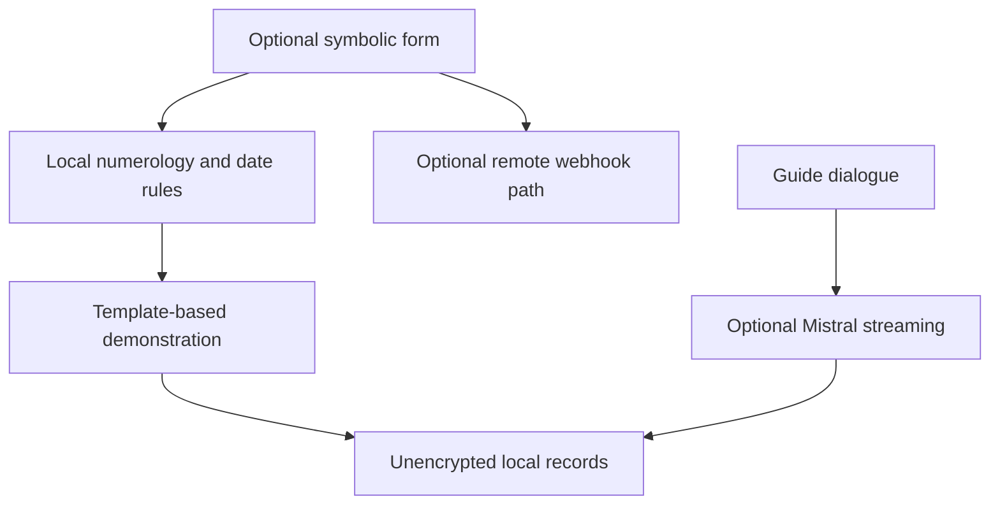

# Codex Akashique — Les Annales Akashiques · Studio Niko Design

**Interactive symbolic narrative · Local demonstration · Optional remote guide**

[Source](index.html) · [Licence](LICENSE.md) · [English overview](#english-overview)

> **Confidentialité :** le journal, les brouillons et la conversation sont sauvegardés via safeStorage sous forme de JSON, sans chiffrement applicatif établi. Ne pas saisir de données intimes ou de secrets réels. Aucun accès à des registres surnaturels ou à des connaissances de l'avenir n'est démontré.

## Architecture constatée

| Fonction dans index.html | Comportement constaté |
| --- | --- |
| computeSoulNumbers | Calculs arithmétiques et correspondances de lettres |
| getZodiac / getLunarNodes | Règles de dates et table annuelle ; aucune éphéméride précise |
| generateDemoReading | Textes de démonstration prédéfinis, personnalisés par les entrées |
| callWebhook | Envoi JSON à un service externe, fonctionnement non vérifié |
| callMistralStream | Chemin de dialogue distant avec clé personnelle |
| saveJournal / saveDraft / saveDialogue | Stockage local, aucune enveloppe AES-GCM ou persistance IndexedDB établie |

Le contenu relève de traditions et de croyances, non d'une méthode scientifique de diagnostic ou de prédiction. Les résultats locaux prédéfinis doivent être distingués des réponses de fournisseurs. 

## Ce que fait l'application, en pratique

**Codex Akashique** propose un **portail d'exploration symbolique** avec rubriques sur les traditions, textes et prières, un guide, un lexique, un cabinet d'analyse interprétative et un **journal personnel**. L'interface vise un parcours de réflexion individuelle, pas une connaissance factuelle de l'avenir.

**Statut :** œuvre interactive autour de croyances et traditions spirituelles. Les lectures sont subjectives et ne relèvent pas de méthodes scientifiques de diagnostic ou de prédiction.

**Studio Niko Design** — Oracle des Registres Akashiques.

> Application de divination et d'exploration spirituelle — numérologie pythagoricienne, nœuds lunaires, journal local non chiffré.

## ✨ Fonctionnalités
- Numérologie pythagoricienne
- Nœuds lunaires
- Journal personnel local (JSON, non chiffré)
- Interface mystique Cormorant Garamond

## 🛠 Stack
`HTML` · `Mistral AI` (optionnel) · `safeStorage`

## 👤 Auteur
**Nicolas Julienne** — [Studio Niko Design](https://github.com/Nikoju1977)
📧 nicolasjulienne.nj@gmail.com

---

## Démarrage, usage et limites

**Thème :** Arts numériques, exploration symbolique & spiritualité.

La page principale `index.html` peut être consultée avec `python3 -m http.server 8000`. L'application se présente comme une expérience d'exploration symbolique ; le terme « annales akashiques », la numérologie et l'astrologie relèvent de croyances et de pratiques interprétatives, non de méthodes scientifiques de prédiction.

Le stockage et les échanges externes imposent de ne pas confier d'informations intimes à ce prototype. Aucun chiffrement ou niveau de sécurité n'a été audité lors de cette mise à jour.

**Statut :** projet de démonstration, sans validation fonctionnelle ou expertise indépendante revendiquée dans cette mise à jour.

[Voir le catalogue des projets](https://github.com/Nikoju1977).

## Qualification proposée

Priorité : supprimer les promesses de chiffrement non établies, rendre explicite le stockage des brouillons et le consentement aux transferts, vérifier la suppression locale et distinguer le mode de démonstration des réponses distantes. Ces corrections applicatives ne sont pas réalisées dans cette révision documentaire. Utiliser uniquement des identités et textes fictifs. Aucun nouveau test, appel webhook ou Mistral exécuté.

## English overview

Codex Akashique is an interactive symbolic narrative with local numerology/date rules, template-based demonstration readings and optional remote webhook or Mistral paths. Journal and draft data are stored as JSON without established application-level encryption. No AES-GCM or IndexedDB implementation was established in the inspected source. Do not enter real intimate information. No supernatural, scientific predictive or clinical claims are supported. No new runtime or deployment verification was performed.

[Notice de droits](LICENSE.md) : droits réservés pour les contributions originales concernées.
